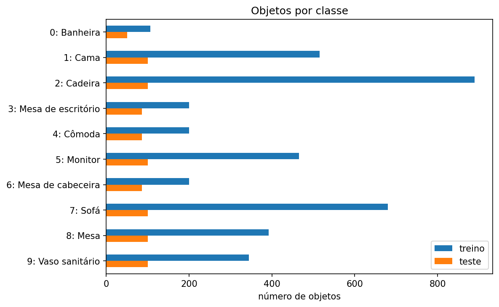
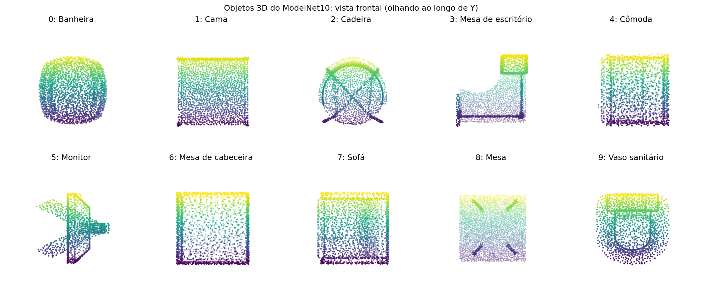
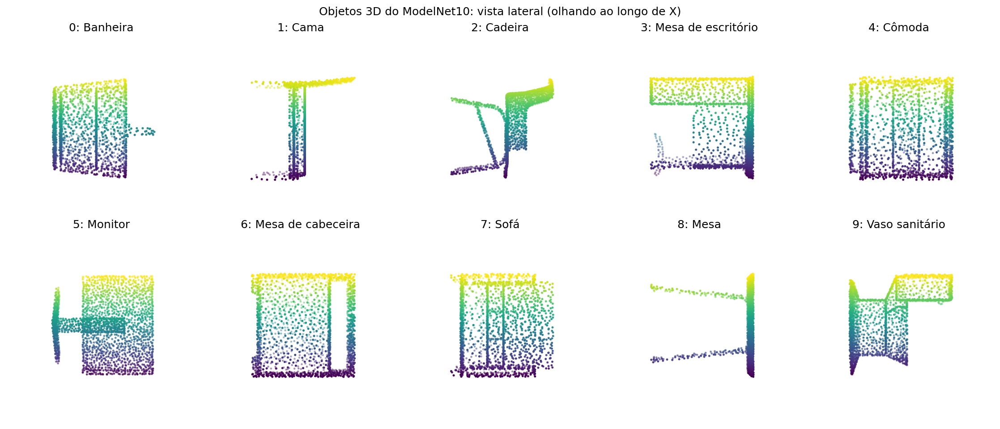
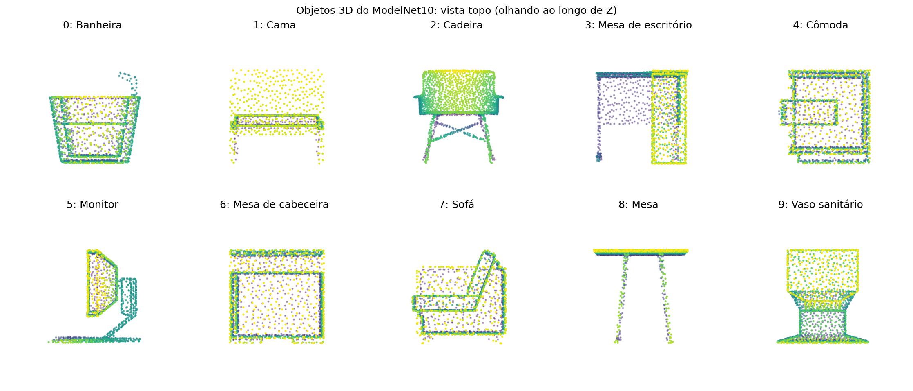
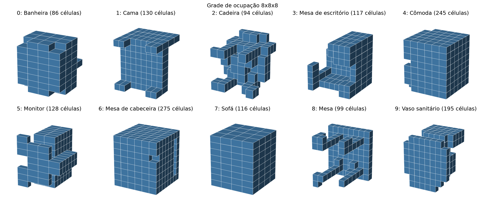
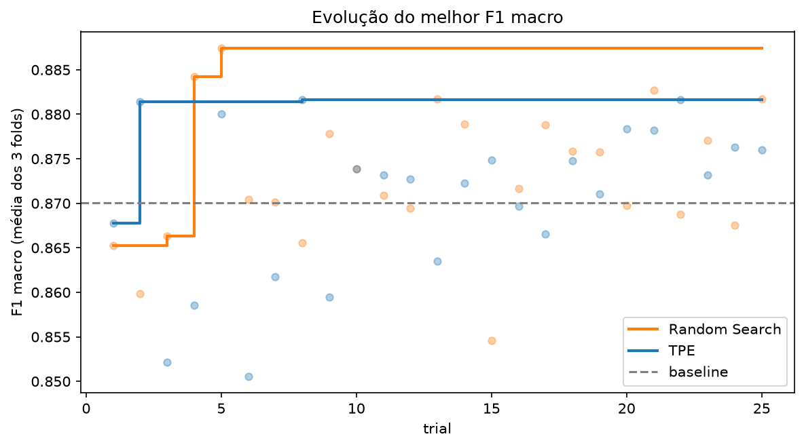
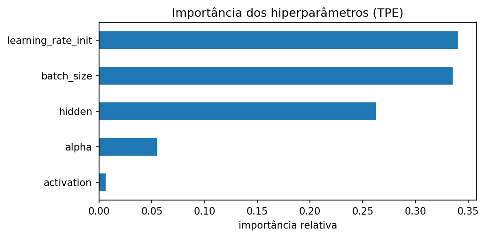
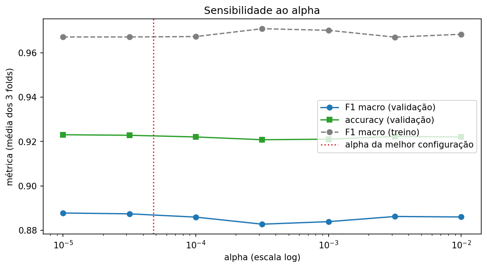

# 3d-mnist-mlp-optimization-v2

    <br>   

Classificação de objetos 3D do **ModelNet10** com uma MLP (`scikit-learn`) e avaliação do efeito do ajuste de hiperparâmetros (Random Search e TPE/Optuna).

Roteiro completo: [doc/step-by-step.md](doc/step-by-step.md). Plano inicial: [doc/planejamento-inicial.md](doc/planejamento-inicial.md).

## Como executar

Python **3.11.9** (ver `.python-version`).

```bash
pip install -r requirements.txt
jupyter notebook notebooks/mlp_modelnet10.ipynb
```

O notebook usa caminhos relativos e deve ser aberto a partir da pasta `notebooks/`.

## Estrutura

| Caminho | Conteúdo |
| --- | --- |
| `notebooks/mlp_modelnet10.ipynb` | Notebook principal, construído por etapas |
| `dataset/modelnet10_hdf5/` | ModelNet10: treino (3.991 objetos) e teste (908 objetos), 2.048 pontos × 3 coordenadas, 10 classes |
| `output/` | Gráficos e tabelas (CSV) gerados pelo notebook (salvos a cada execução) |
| `doc/` | Planejamento inicial e guia passo a passo |
| `AGENTS.md` | Regras do repositório para agentes de IA que editam o notebook |
| `requirements.txt` | Dependências, com as versões das bibliotecas principais |

## Status da implementação

As etapas seguem a numeração do guia. O notebook usa a mesma numeração nos títulos.

| Etapa | Descrição | Status |
| --- | --- | --- |
| 1 | Validar o dataset com a professora | Pendente (não é código) |
| 0 | Ambiente e configuração (versões, seed 42, caminhos, nomes das classes) | Feita |
| 2 | Carregar e conferir os dados | Feita |
| 3 | Preparar a entrada da MLP (grade 8×8×8) | Feita |
| 4 | Validação cruzada de 3 folds e baseline | Feita |
| 5 | Random Search (25) e TPE com Optuna (25) | Feita |
| 6 | Análises de sensibilidade (`alpha`) | Feita |
| 7 | Modelo final e avaliação no teste | A fazer |
| 8 | Interpretação e apresentação | A fazer |

### Etapa 2: carregar e conferir os dados

- Leitura dos arquivos `.h5` com `h5py` (`data`: nuvens, `label`: classe de 0 a 9).
- Conferência de dimensões, rótulos, valores ausentes (NaN/inf) e faixa das coordenadas. Nenhum valor inválido foi encontrado.
- Distribuição por classe: o treino é desbalanceado (de 106 a 889 objetos por classe) e o teste é mais uniforme (cerca de 100 por classe). Isso justifica validação estratificada e **F1 macro**.
- Os arquivos trazem só os ids das classes. Os nomes usados no notebook seguem a ordem alfabética padrão do ModelNet10 e foram conferidos visualmente.
- Gráficos: barras de objetos por classe e o mesmo objeto em três vistas (frontal, lateral e topo).
- O conjunto de teste é apenas inspecionado, nunca usado em decisões.

**Objetos por classe**



*Figura 1: número de objetos por classe nos conjuntos de treino e teste.*

**O mesmo objeto em três vistas (frontal, lateral e topo)**



*Figura 2: vista frontal (olhando ao longo do eixo Y) dos mesmos objetos.*



*Figura 3: vista lateral (olhando ao longo do eixo X) dos mesmos objetos.*



*Figura 4: vista de topo (olhando ao longo do eixo Z) dos mesmos objetos.*

### Etapa 3: grade de ocupação 8×8×8

Cada nuvem de 2.048 pontos vira um vetor binário de **512 atributos** (função `voxelize`):

1. Centraliza o objeto no centro da sua caixa delimitadora.
2. Divide pela maior extensão, o que coloca o objeto no cubo [0, 1]³ sem deformar a proporção.
3. Calcula a célula de cada ponto e marca as células ocupadas com 1.

A transformação é determinística e usa só os pontos de cada objeto, então vale igualmente para treino e teste, sem ajuste com o teste. Resultado: `X_train` com 3.991 × 512 e `X_test` com 908 × 512, sem objetos vazios e com cerca de 25% das células ocupadas.



*Figura 5: um objeto de cada classe como grade de ocupação 8×8×8; cada cubo preenchido é uma célula com algum ponto.*

Limitação: a normalização por objeto descarta o tamanho absoluto, e a grade grossa pode misturar detalhes finos.

### Etapa 4: validação cruzada e baseline

- **Folds:** `StratifiedKFold` com 3 folds, `shuffle=True` e seed 42, aplicado só ao treino. Os folds são criados uma vez (`FOLDS`) e reutilizados em todos os experimentos. A proporção de cada classe é praticamente igual entre os folds.
- **Pipeline:** `StandardScaler` + `MLPClassifier`, com a padronização ajustada dentro de cada fold.
- **Parâmetros fixos** (`FIXED_PARAMS`, reaproveitados nas buscas): Adam, `max_iter=200` e parada antecipada (`early_stopping=True`, `n_iter_no_change=10`).
- **Métricas:** F1 macro (principal), accuracy, tempo de treino e F1 macro no treino do fold, para diagnosticar overfitting.
- **Baseline:** MLP com os valores padrão do scikit-learn (uma camada de 100 neurônios, ReLU, `alpha=1e-4`, taxa `1e-3`), sem busca.

Resultado do baseline (média ± desvio entre os 3 folds):

| Métrica | Valor |
| --- | --- |
| F1 macro (validação) | 0,870 ± 0,008 |
| Accuracy (validação) | 0,916 ± 0,006 |
| F1 macro (treino do fold) | 0,963 ± 0,018 |
| Tempo por fold | 1,5 s |

O F1 macro é menor que a accuracy, o que indica que as classes pequenas têm desempenho pior. A diferença de cerca de 0,09 entre treino e validação sugere algum overfitting, a ser comparado com os modelos ajustados. O resumo fica em `output/baseline_cv.csv`.

### Etapa 5: Random Search e TPE

Duas buscas com o **mesmo espaço**, os **mesmos folds** (`FOLDS`), a mesma métrica (F1 macro médio nos 3 folds) e a mesma seed, cada uma com **25 configurações**. O teste não participa.

| Hiperparâmetro | Espaço de busca |
| --- | --- |
| Camadas ocultas | `(64,)`, `(128,)` ou `(64, 64)` |
| Ativação | ReLU ou tanh |
| `alpha` | 1e-5 a 1e-2 (escala log) |
| Taxa de aprendizado | 1e-4 a 1e-2 (escala log) |
| Tamanho do lote | 32, 64 ou 128 |

A função `evaluate_config` é a mesma nas duas buscas. O Random Search sorteia com `np.random.default_rng(42)` e o TPE usa `optuna.samplers.TPESampler(seed=42)`.

**Resultados (validação cruzada, 3 folds)**

| Método | F1 macro | Accuracy | F1 macro no treino | Tempo da busca |
| --- | --- | --- | --- | --- |
| Baseline | 0,870 | 0,916 | 0,963 | n/a |
| Random Search | **0,887** | 0,923 | 0,967 | 579 s |
| TPE | 0,882 | 0,922 | 0,974 | 391 s |

**Melhores configurações**

| Método | Camadas | Ativação | `alpha` | Taxa | Lote | Trial |
| --- | --- | --- | --- | --- | --- | --- |
| Random Search | `(128,)` | ReLU | 4,8e-5 | 1,3e-3 | 128 | 5 |
| TPE | `(64,)` | ReLU | 1,5e-3 | 3,5e-3 | 64 | 8 |

A melhor configuração geral, usada nas próximas etapas, é a do Random Search (`BEST_CFG`). Leituras iniciais:

- As duas buscas superam o baseline (16 de 25 trials de cada uma ficam acima de 0,870), mas o ganho é pequeno, cerca de 0,01 a 0,02 de F1 macro.
- A diferença entre Random Search e TPE (0,006) é próxima do desvio entre folds do baseline (0,008), então com 25 trials não dá para afirmar que um método é melhor. O TPE melhorou depressa, no trial 2, mas não passou de 0,882.
- Os tempos de busca não permitem concluir qual método é mais rápido: eles variam bastante entre execuções (em outra execução o Random Search levou 333 s e o TPE 656 s) e dependem das configurações sorteadas (taxas de aprendizado baixas treinam mais devagar). Na última execução, o notebook rodou ao mesmo tempo que outro processo, o que também distorce a medida.
- Importância estimada pelo TPE: taxa de aprendizado (0,34), tamanho do lote (0,33) e camadas (0,26) pesam mais, `alpha` (0,06) e ativação (0,01) quase não importam. Com 25 trials, isso é só indicativo.



*Figura 6: evolução das buscas. Cada ponto é o F1 macro médio (3 folds) de um trial, em laranja no Random Search e em azul no TPE; as linhas em degrau mostram o melhor valor acumulado e a linha tracejada é o baseline.*



*Figura 7: importância relativa de cada hiperparâmetro estimada pelo Optuna a partir dos 25 trials do TPE (soma 1; apenas indicativa).*

Tabelas completas dos trials: `output/random_search_trials.csv`, `output/tpe_trials.csv` e `output/comparacao_baseline_buscas.csv`.

### Etapa 6: sensibilidade do `alpha`

Variação de **um** hiperparâmetro, o `alpha` (regularização L2), com 7 valores em escala logarítmica de 1e-5 a 1e-2. Os demais ficam na melhor configuração das buscas (`BEST_CFG`), com os mesmos folds e a mesma métrica; o teste não participa.

| `alpha` | F1 macro (validação) | Accuracy (validação) | F1 macro (treino) |
| --- | --- | --- | --- |
| 1e-5 | **0,888** | 0,923 | 0,967 |
| 3,2e-5 | 0,887 | 0,923 | 0,967 |
| 1e-4 | 0,886 | 0,922 | 0,967 |
| 3,2e-4 | 0,883 | 0,921 | 0,971 |
| 1e-3 | 0,884 | 0,921 | 0,970 |
| 3,2e-3 | 0,886 | 0,922 | 0,967 |
| 1e-2 | 0,886 | 0,922 | 0,968 |

- O F1 macro de validação varia só de 0,883 a 0,888. Essa diferença (cerca de 0,005) é menor que o desvio entre folds do baseline (0,008), então o efeito do `alpha` não se distingue do ruído. Isso combina com a importância baixa do `alpha` no TPE.
- O F1 macro no treino fica quase constante (0,967 a 0,971): regularizar mais não diminuiu a diferença de cerca de 0,08 entre treino e validação. O `alpha` sozinho não resolve o overfitting.
- Limitação: um único hiperparâmetro, com os demais fixos e a mesma seed em todos os valores.



*Figura 8: F1 macro e accuracy de validação (linhas azul e verde) e F1 macro no treino (tracejada cinza) para cada valor de `alpha`, em escala logarítmica; a linha vertical vermelha pontilhada marca o `alpha` da melhor configuração das buscas.*

Tabela completa em `output/sensibilidade_alpha.csv`.
