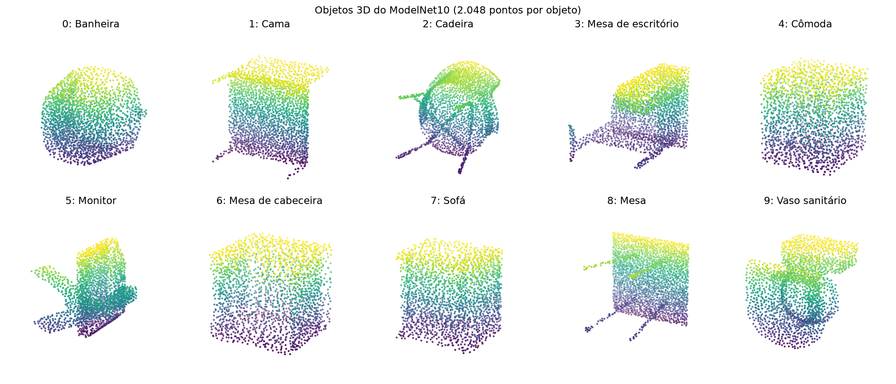

# 3d-mnist-mlp-optimization-v2


Classificação de objetos 3D do **ModelNet10** com uma MLP (`scikit-learn`) e avaliação do efeito do ajuste de hiperparâmetros (Random Search e TPE/Optuna).

Roteiro completo: [doc/step-by-step/README.md](doc/step-by-step/README.md). Plano resumido: [PLANEJAMENTO-TRABALHO-MLP.md](PLANEJAMENTO-TRABALHO-MLP.md).

## Como executar

Python **3.11.9** (ver `.python-version`).

```bash
pip install -r requirements.txt
jupyter notebook notebooks/mlp_modelnet10.ipynb
```

O notebook usa caminhos relativos e deve ser aberto a partir da pasta `notebooks/`.

## Estrutura

| Caminho | Conteúdo |
| --- | --- |
| `notebooks/mlp_modelnet10.ipynb` | Notebook principal, construído por etapas |
| `dataset/modelnet10_hdf5/` | ModelNet10: treino (3.991 objetos) e teste (908 objetos), 2.048 pontos × 3 coordenadas, 10 classes |
| `output/` | Gráficos gerados pelo notebook (salvos a cada execução) |
| `doc/` | Documentação e guia passo a passo |
| `requirements.txt` | Dependências, com as versões das bibliotecas principais |

## Status da implementação

As etapas seguem a numeração do guia. O notebook usa a mesma numeração nos títulos.

| Etapa | Descrição | Status |
| --- | --- | --- |
| 1 | Validar o dataset com a professora | Pendente (não é código) |
| 0 | Ambiente e configuração (versões, seed 42, caminhos, nomes das classes) | Feita |
| 2 | Carregar e conferir os dados | Feita |
| 3 | Preparar a entrada da MLP (grade 8×8×8) | Feita |
| 4 | Validação cruzada de 3 folds e baseline | A fazer |
| 5 | Random Search (25) e TPE com Optuna (25) | A fazer |
| 6 | Análises de sensibilidade | A fazer |
| 7 | Modelo final e avaliação no teste | A fazer |
| 8 | Interpretação e apresentação | A fazer |

### Etapa 2: carregar e conferir os dados

- Leitura dos arquivos `.h5` com `h5py` (`data`: nuvens, `label`: classe de 0 a 9).
- Conferência de dimensões, rótulos, valores ausentes (NaN/inf) e faixa das coordenadas. Nenhum valor inválido foi encontrado.
- Distribuição por classe: o treino é desbalanceado (de 106 a 889 objetos por classe) e o teste é mais uniforme (cerca de 100 por classe). Isso justifica validação estratificada e **F1 macro**.
- Os arquivos trazem só os ids das classes. Os nomes usados no notebook seguem a ordem alfabética padrão do ModelNet10 e foram conferidos visualmente.
- Gráficos: barras de objetos por classe e um exemplo 3D de cada classe.
- O conjunto de teste é apenas inspecionado, nunca usado em decisões.

**Objetos por classe**


**Um exemplo de cada classe**



### Etapa 3: grade de ocupação 8×8×8

Cada nuvem de 2.048 pontos vira um vetor binário de **512 atributos** (função `voxelize`):

1. Centraliza o objeto no centro da sua caixa delimitadora.
2. Divide pela maior extensão, o que coloca o objeto no cubo [0, 1]³ sem deformar a proporção.
3. Calcula a célula de cada ponto e marca as células ocupadas com 1.

A transformação é determinística e usa só os pontos de cada objeto, então vale igualmente para treino e teste, sem ajuste com o teste. Resultado: `X_train` com 3.991 × 512 e `X_test` com 908 × 512, sem objetos vazios e com cerca de 25% das células ocupadas.


Limitação: a normalização por objeto descarta o tamanho absoluto, e a grade grossa pode misturar detalhes finos.

## Aprovação do dataset

O guia pede que a professora valide o dataset antes do pré-processamento. Essa aprovação ainda precisa ser confirmada.
